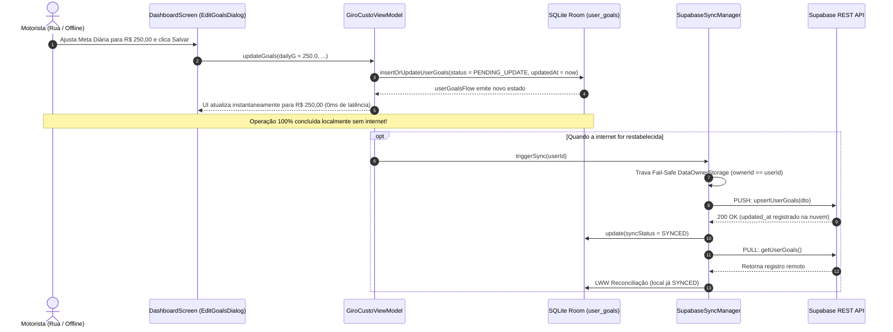

# Desenho Técnico: Sincronização e Persistência de Metas por Conta (T-28A / ARQ-06A)

**Data:** 26 de Outubro de 2026  
**Autor:** Agente Arquiteto (com competência de Banco de Dados)  
**Status do Documento:** Concluído — Pronto para Avaliação e Decisão do Proprietário do Projeto  
**Classificação de Risco da Tarefa:** Médio (T-28A: Desenho Técnico) / Alto (T-28B: Implementação de Dados e Sync)  
**Documentos de Referência:**
- [docs/plano-onda-2.md](file:///home/nando/Documentos/GiroCustov0.1/docs/plano-onda-2.md) (Seção 3.d.1 e Seção 6 - Ajustes v2.2)
- [docs/design-isolamento-contas.md](file:///home/nando/Documentos/GiroCustov0.1/docs/design-isolamento-contas.md) (Arquitetura de Isolamento T-06c)
- [.agents/rules/equipe-agentes.md](file:///home/nando/Documentos/GiroCustov0.1/.agents/rules/equipe-agentes.md)
- [.agents/rules/equipe-especialistas.md](file:///home/nando/Documentos/GiroCustov0.1/.agents/rules/equipe-especialistas.md)
- [.agents/rules/padroes-seguranca-ux.md](file:///home/nando/Documentos/GiroCustov0.1/.agents/rules/padroes-seguranca-ux.md)

---

## 1. Visão Geral e Contexto

### 1.1 O Problema no Código Atual
No aplicativo atual, as 12 metas operacionais e financeiras do entregador (faturamento bruto, lucro líquido, quilometragem e quantidade de entregas, divididas em períodos diário, semanal e mensal) são armazenadas no arquivo local `giro_custo_goals.xml` utilizando a API `SharedPreferences` do Android, conforme implementado em [`app/src/main/java/com/example/ui/GiroCustoViewModel.kt:406-432`](file:///home/nando/Documentos/GiroCustov0.1/app/src/main/java/com/example/ui/GiroCustoViewModel.kt#L406-L432).

Essa abordagem apresenta três falhas estruturais graves:

1. **Destruição de Dados na Troca de Conta:**  
   No método [`resetAccountSpecificPreferences()`](file:///home/nando/Documentos/GiroCustov0.1/app/src/main/java/com/example/ui/GiroCustoViewModel.kt#L954-L976), acionado quando um usuário faz login em um dispositivo previamente utilizado por outra conta e confirma o descarte de dados (`confirmDiscardData`), o sistema executa `prefs.edit().clear()`. Com isso, todas as metas que o motorista personalizou são sumariamente apagadas e resetadas para valores genéricos fixos (*hardcoded*), sem qualquer possibilidade de recuperação.
2. **Ausência de Sincronização Multi-Dispositivo:**  
   Por residirem exclusivamente em arquivo local não estruturado, as metas não acompanham o motorista quando ele troca de celular, instala o aplicativo em um novo aparelho ou reinstala o app após formatação.
3. **Acoplamento Indevido de Preferência Global com Metas:**  
   O arquivo `giro_custo_goals.xml` foi indevidamente reutilizado para armazenar a preferência de interface global de tema escuro (`is_dark_theme`). Para contornar a destruição do tema durante o `clear()`, o código precisou adotar um artifício paliativo nas linhas 958-959:
   ```kotlin
   val dark = prefs.getBoolean("is_dark_theme", true)
   prefs.edit().clear().putBoolean("is_dark_theme", dark).apply()
   ```
   Essa mistura de conceitos (metas de negócio de um usuário específico misturadas com uma configuração visual global do dispositivo) viola os princípios de coesão e responsabilidade única.

### 1.2 A Decisão do Usuário: Opção B (Sincronização na Nuvem)
Durante o planejamento da Onda 2, o proprietário do projeto deliberou expressamente pela **Opção B**: as metas de faturamento, quilometragem e entregas devem ser persistidas de forma estruturada no banco de dados local Room e sincronizadas na nuvem Supabase, passando a pertencer à conta autenticada do motorista (`user_id`).

### 1.3 Escopo: T-28A (Desenho Técnico) vs. T-28B (Implementação)
- **T-28A [ARQ-06A] (Esta Tarefa):** Diagnóstico aprofundado no código real, inventário completo de preferências, comparação arquitetural de modelagem, especificação de schemas (Room e Supabase PostgreSQL com RLS), definição da regra de conflito LWW, valores padrão com embasamento econômico, estratégia de migração sem perda de dados, isolamento multi-conta e plano detalhado de testes automatizados e manuais. **ESTRITAMENTE SEM CÓDIGO**.
- **T-28B [DAT-03] (Próxima Tarefa):** Implementação concreta no Room (v14 com `MIGRATION_13_14` e schema `14.json`), criação da tabela e políticas no Supabase (`20261026_user_goals.sql`), DTOs, mappers, integração no `SupabaseSyncManager`, refatoração no `GiroCustoViewModel` e testes automatizados. A T-28B depende da aprovação deste documento e da conclusão prévia da migração de índices da T-08 (v13).

---

## 2. Inventário Exaustivo de SharedPreferences e Preferências Locais

Uma varredura completa no código-fonte do projeto identificou exatamente 5 arquivos de `SharedPreferences` em uso. Abaixo está o mapeamento detalhado de cada arquivo, suas chaves, tipos, valores padrão e comportamento durante a operação do aplicativo.

### 2.1 Arquivo 1: `giro_custo_goals.xml`
- **Origem no Código:** [`app/src/main/java/com/example/ui/GiroCustoViewModel.kt:407`](file:///home/nando/Documentos/GiroCustov0.1/app/src/main/java/com/example/ui/GiroCustoViewModel.kt#L407) (`application.getSharedPreferences("giro_custo_goals", Context.MODE_PRIVATE)`).
- **Escopo e Conteúdo:** Armazena as 12 metas operacionais do motorista e a preferência global de tema escuro.

| Chave Exata | Tipo Primitivo | Valor Padrão | Tipo Exposto no ViewModel | Propósito de Negócio no App |
| :--- | :---: | :---: | :---: | :--- |
| `daily_goal_gross` | `Float` | `200.0f` | `Double` | Meta de faturamento bruto diário em reais. Utilizada no card "Meta Diária" da Dashboard. |
| `daily_goal_net` | `Float` | `130.0f` | `Double` | Meta de lucro líquido diário em reais (após combustível, manutenção e custos fixos). |
| `daily_goal_km` | `Float` | `100.0f` | `Double` | Teto ou planejamento de quilômetros a rodar no dia. |
| `daily_goal_deliveries`| `Int` | `15` | `Int` | Quantidade mínima de entregas ou corridas planejadas para o dia. |
| `weekly_goal_gross` | `Float` | `1200.0f`| `Double` | Meta de faturamento bruto acumulado na semana (ciclo de 6 a 7 dias). |
| `weekly_goal_net` | `Float` | `800.0f` | `Double` | Meta de lucro líquido semanal em reais. |
| `weekly_goal_km` | `Float` | `600.0f` | `Double` | Limite ou projeção de quilômetros semanais. |
| `weekly_goal_deliveries`| `Int`| `90` | `Int` | Quantidade planejada de entregas semanais. |
| `monthly_goal_gross` | `Float` | `5000.0f`| `Double` | Meta mensal de faturamento bruto para sustento e operação. |
| `monthly_goal_net` | `Float` | `3200.0f`| `Double` | Meta de rendimento líquido mensal livre de custos. |
| `monthly_goal_km` | `Float` | `2500.0f`| `Double` | Projeção mensal de rodagem para controle de depreciação veicular. |
| `monthly_goal_deliveries`| `Int`| `400` | `Int` | Volume total de entregas mensais. |
| `is_dark_theme` | `Boolean` | `true` | `Boolean` | Preferência global de interface (Tema Escuro ativado vs. Tema Claro). |

#### Diagnóstico do Acoplamento de `is_dark_theme`
A chave `is_dark_theme` não possui nenhuma relação com contas de usuário, metas financeiras ou regras de negócio do motorista. Trata-se de uma preferência do dispositivo/usuário físico. O fato de residir em `giro_custo_goals` gerou uma dependência circular frágil no método `resetAccountSpecificPreferences()`:
- Para resetar as preferências específicas de conta, o código precisava invocar `prefs.edit().clear()`.
- O `clear()` destruía o arquivo inteiro, incluindo `is_dark_theme`.
- Foi necessário criar uma variável temporária `val dark = prefs.getBoolean("is_dark_theme", true)` e regravar a chave logo em seguida.
- **Diretriz de Correção na T-28B:** Desacoplar totalmente `is_dark_theme`, migrando-a para um arquivo independente de preferências do aplicativo (`giro_custo_app_prefs.xml`), blindando as escolhas visuais contra qualquer alteração de conta ou limpeza de dados locais.

### 2.2 Arquivo 2: `giro_custo_sync_prefs.xml`
- **Origem no Código:** [`app/src/main/java/com/example/ui/GiroCustoViewModel.kt:109`](file:///home/nando/Documentos/GiroCustov0.1/app/src/main/java/com/example/ui/GiroCustoViewModel.kt#L109) (`application.getSharedPreferences("giro_custo_sync_prefs", Context.MODE_PRIVATE)`).
- **Chave Única:** `last_sync_timestamp` (`Long`, default `0L`).
- **Propósito:** Armazena o instante exato (milissegundos via `System.currentTimeMillis()`) em que ocorreu a última sincronização bem-sucedida entre o banco Room e o Supabase. Exibido na interface do usuário (ex.: "Sincronizado há 5 minutos").
- **Comportamento no Reset:** Em [`GiroCustoViewModel.kt:955`](file:///home/nando/Documentos/GiroCustov0.1/app/src/main/java/com/example/ui/GiroCustoViewModel.kt#L955), `syncPrefs.edit().remove("last_sync_timestamp").apply()` é executado corretamente. Quando o motorista troca de conta, o timestamp da conta anterior deve de fato ser removido para que a nova conta exiba estado não sincronizado até a conclusão do primeiro sync. Este comportamento está correto e será mantido.

### 2.3 Outros Arquivos de Preferências Locais (Que NÃO Devem Ser Afetados)
1. **`giro_custo_data_owner.xml`:**  
   - Criado na Tarefa T-06c ([`app/src/main/java/com/example/data/DataOwnerStorage.kt:61`](file:///home/nando/Documentos/GiroCustov0.1/app/src/main/java/com/example/data/DataOwnerStorage.kt#L61)).
   - Contém a chave `local_data_owner_user_id` (`String`).
   - Define a propriedade e o vínculo exclusivo dos dados locais com o `userId` autenticado.
   - **Por que não é afetado:** Seu ciclo de vida é gerido estritamente pelas rotinas de controle de dono (`DataOwnerStorage`), pelas travas fail-safe da T-30 e pela máquina de estados `AccountConflictState`. Nunca é limpo arbitrariamente por reset de metas.
2. **`giro_custo_secure_session.xml`:**  
   - Criado na Tarefa T-06 ([`app/src/main/java/com/example/network/supabase/SecureSessionStorage.kt:26`](file:///home/nando/Documentos/GiroCustov0.1/app/src/main/java/com/example/network/supabase/SecureSessionStorage.kt#L26)).
   - Armazena a sessão JWT (`accessToken`, `refreshToken`, `userId`, `userEmail`) criptografada via Android Keystore (AES-GCM). Excluído de backups de nuvem e USB.
   - **Por que não é afetado:** Trata-se de dados criptográficos sensíveis de autenticação. É manipulado exclusivamente por `SupabaseClient` e `EncryptedSharedPreferencesStorage`.
3. **`giro_custo_biometrics.xml`:**  
   - Criado na Tarefa T-06 ([`app/src/main/java/com/example/util/BiometricHelper.kt:78`](file:///home/nando/Documentos/GiroCustov0.1/app/src/main/java/com/example/util/BiometricHelper.kt#L78)).
   - Armazena `biometric_enabled`, `biometric_user_email` e o payload do desafio criptográfico (`challenge_iv`, `challenge_ciphertext`). Excluído de backups.
   - **Por que não é afetado:** Exclusivo para desbloqueio por impressão digital. Manipulado unicamente por `BiometricHelper`.

---

## 3. Item (a): Localização e Modelagem dos Dados (Room e Supabase)

### 3.1 Análise Comparativa Aprofundada: Colunas em `user_profile` vs. Tabela Dedicada `user_goals`

Para determinar onde e como as metas devem ser persistidas, realizamos um confronto arquitetural aprofundado entre duas abordagens possíveis.

```mermaid
classDiagram
    direction LR
    class Abordagem_A_UserProfile_Inadequada {
        +UUID id
        +UUID user_id
        +String name
        +String phone
        +String cep
        +String street
        +Double daily_goal_gross
        +Double daily_goal_net
        +Double weekly_goal_gross
        +Double monthly_goal_gross
        Nota: Viola SRP, Conflito LWW em CEP
        Trafega perfil em toda edicao de meta
    }

    class Abordagem_B_Separacao_Recomendada {
        <<Tabela user_profile>>
        +UUID id
        +UUID user_id
        +String name
        +String phone
        +String cep
        +String street
    }

    class Tabela_user_goals_Dedicada {
        <<Tabela user_goals>>
        +UUID id
        +UUID user_id
        +Double daily_goal_gross
        +Double daily_goal_net
        +Double weekly_goal_gross
        +Double monthly_goal_gross
        Nota: SRP estrito, Sync atomico
        LWW isolado sem colisao cadastral
    }

    Abordagem_B_Separacao_Recomendada .. Tabela_user_goals_Dedicada : Cardinalidade 1:1 estrita
```

| Critério Técnico | Opção 1: Colunas em `user_profile` | Opção 2: Tabela Dedicada `user_goals` (Recomendada) | Vantagem da Opção 2 |
| :--- | :--- | :--- | :--- |
| **Princípio de Responsabilidade Única (SRP)** | **Violação Grave:** Mistura dados cadastrais civis e endereço com metas e projeções financeiras. | **Alta Coesão:** Cada entidade cuida estritamente do seu domínio de negócio. | Separação clara de responsabilidades no domínio e código. |
| **Frequência de Atualização** | Perfil é alterado raramente (no onboarding ou mudança de endereço). Metas mudam com frequência. | Metas são atualizadas periodicamente (semanalmente, mensalmente ou após oscilação de combustível). | Evita disparar rotinas de perfil em alterações puramente operacionais. |
| **Tamanho de Payload e Tráfego 4G** | **Desperdício:** Toda alteração de meta trafega nome, telefone, CEP, rua, número, bairro e UF no payload JSON. | **Otimizado:** Trafega estritamente os 12 números das metas, economizando bateria e dados móveis do entregador. | Redução drástica de overhead em redes móveis instáveis. |
| **Concorrência e Conflitos de LWW** | **Risco Crítico de Sobrescrita:** Se o motorista atualizar o CEP e, em outro instante offline, alterar uma meta, o LWW baseado no `updated_at` do perfil inteiro sobrescreverá uma das alterações com dados defasados. | **Conflitos Isolados:** Atualizar metas jamais colide com alterações de endereço ou nome, pois possuem `updatedAt` e ciclo LWW independentes. | Elimina risco de corromper dados cadastrais ao sincronizar metas. |
| **Modelagem no Room (Local SQLite)** | `UserProfile` no Room possui `@PrimaryKey val id: Int = 1`. Incharia uma entidade que já possui 16 colunas para 28 colunas. | Segue com exatidão o mesmo padrão arquitetural já consagrado no projeto: entidade `UserGoals` com `@PrimaryKey val id: Int = 1`. | Consistência de design de singleton local no SQLite. |
| **Impacto na Migração Monetária (T-18B)** | Na Onda 3 (T-18B), valores monetários migrarão de `Double` para centavos (`Long`). Se as metas estivessem em `user_profile`, a migração v15 exigiria alterar o schema do perfil cadastral. | A tabela `user_goals` isola os 6 campos monetários (`gross` e `net`), permitindo que a T-18B execute a migração de centavos com risco cirúrgico zero para o perfil. | Proteção e isolamento para a evolução futura da base de dados. |

### 3.2 Decisão Arquitetural Justificada
**Decisão:** Adotar compulsoriamente a **Tabela Dedicada `user_goals`** tanto no banco local Room quanto no banco remoto Supabase PostgreSQL.  
A separação garante integridade referencial, sincronização REST atômica, isolamento absoluto de concorrência com o perfil cadastral e perfeita compatibilidade com o padrão de *singleton* de usuário único por aparelho já utilizado no GiroCusto.

---

### 3.3 Modelagem no Room (Versão 14, pós-T-08 v13)

Conforme estabelecido na Nota Global de Versionamento de `docs/plano-onda-2.md`:
- Versão 12: Versão atual do banco Room.
- Versão 13 (Tarefa T-08): Introdução de índices nas 7 tabelas existentes (`13.json`).
- Versão 14 (Tarefa T-28B): Criação da tabela `user_goals` (`14.json`).
- Versão 15 (Tarefa T-18B): Migração monetária para centavos `Long` (`15.json`).

#### 3.3.1 Entidade Kotlin (`UserGoals.kt` ou em `Entities.kt`)
```kotlin
package com.example.data

import androidx.room.Entity
import androidx.room.PrimaryKey

/**
 * Entidade Room que armazena as metas operacionais e financeiras do motorista.
 * Opera como singleton local isolado (id = 1), sincronizado com o Supabase.
 */
@Entity(tableName = "user_goals")
data class UserGoals(
    @PrimaryKey val id: Int = 1,
    
    // Metas Diárias
    val dailyGoalGross: Double = 200.0,
    val dailyGoalNet: Double = 130.0,
    val dailyGoalKm: Double = 100.0,
    val dailyGoalDeliveries: Int = 15,

    // Metas Semanais
    val weeklyGoalGross: Double = 1200.0,
    val weeklyGoalNet: Double = 800.0,
    val weeklyGoalKm: Double = 600.0,
    val weeklyGoalDeliveries: Int = 90,

    // Metas Mensais
    val monthlyGoalGross: Double = 5000.0,
    val monthlyGoalNet: Double = 3200.0,
    val monthlyGoalKm: Double = 2500.0,
    val monthlyGoalDeliveries: Int = 400,

    // Campos de Sincronização e Resolução de Conflitos
    @androidx.room.ColumnInfo(defaultValue = "")
    val remoteId: String = "",
    @androidx.room.ColumnInfo(defaultValue = "SYNCED")
    val syncStatus: String = SyncStatus.SYNCED,
    @androidx.room.ColumnInfo(defaultValue = "0")
    val updatedAt: Long = System.currentTimeMillis(),
    @androidx.room.ColumnInfo(defaultValue = "0")
    val isDeleted: Boolean = false
)
```

#### 3.3.2 DAO Room (`UserGoalsDao.kt` ou em `Daos.kt`)
```kotlin
package com.example.data

import androidx.room.Dao
import androidx.room.Insert
import androidx.room.OnConflictStrategy
import androidx.room.Query
import kotlinx.coroutines.flow.Flow

@Dao
interface UserGoalsDao {
    @Query("SELECT * FROM user_goals WHERE id = 1 AND isDeleted = 0 LIMIT 1")
    fun getUserGoalsFlow(): Flow<UserGoals?>

    @Query("SELECT * FROM user_goals WHERE id = 1 LIMIT 1")
    suspend fun getUserGoals(): UserGoals?

    @Query("SELECT * FROM user_goals WHERE remoteId = :remoteId LIMIT 1")
    suspend fun getUserGoalsByRemoteId(remoteId: String): UserGoals?

    @Query("SELECT * FROM user_goals WHERE syncStatus != 'SYNCED' LIMIT 1")
    suspend fun getPendingUserGoals(): UserGoals?

    @Insert(onConflict = OnConflictStrategy.REPLACE)
    suspend fun insertOrUpdateUserGoals(goals: UserGoals)

    @Query("DELETE FROM user_goals")
    suspend fun deleteAllGoals()
}
```

#### 3.3.3 Migração Room (`MIGRATION_13_14`)
```kotlin
val MIGRATION_13_14 = object : Migration(13, 14) {
    override fun migrate(db: SupportSQLiteDatabase) {
        db.execSQL(
            """
            CREATE TABLE IF NOT EXISTS `user_goals` (
                `id` INTEGER NOT NULL,
                `dailyGoalGross` REAL NOT NULL,
                `dailyGoalNet` REAL NOT NULL,
                `dailyGoalKm` REAL NOT NULL,
                `dailyGoalDeliveries` INTEGER NOT NULL,
                `weeklyGoalGross` REAL NOT NULL,
                `weeklyGoalNet` REAL NOT NULL,
                `weeklyGoalKm` REAL NOT NULL,
                `weeklyGoalDeliveries` INTEGER NOT NULL,
                `monthlyGoalGross` REAL NOT NULL,
                `monthlyGoalNet` REAL NOT NULL,
                `monthlyGoalKm` REAL NOT NULL,
                `monthlyGoalDeliveries` INTEGER NOT NULL,
                `remoteId` TEXT NOT NULL DEFAULT '',
                `syncStatus` TEXT NOT NULL DEFAULT 'SYNCED',
                `updatedAt` INTEGER NOT NULL DEFAULT 0,
                `isDeleted` INTEGER NOT NULL DEFAULT 0,
                PRIMARY KEY(`id`)
            )
            """.trimIndent()
        )
        // Índices para buscas rápidas em rotinas de sync
        db.execSQL("CREATE INDEX IF NOT EXISTS `index_user_goals_remoteId` ON `user_goals` (`remoteId`)")
        db.execSQL("CREATE INDEX IF NOT EXISTS `index_user_goals_syncStatus` ON `user_goals` (`syncStatus`)")
    }
}
```

---

### 3.4 Modelagem no Supabase (PostgreSQL)

O script SQL abaixo será entregue na Tarefa T-28B no caminho `supabase/migrations/20261026_user_goals.sql`.  
Conforme a Regra 6 de `equipe-agentes.md`, o status desta migração remota é inicialmente ⛔ **BLOQUEADO** até que o usuário execute o script manualmente no painel web do Supabase (**SQL Editor**).

```sql
-- ==============================================================================
-- GiroCusto - Tabela de Metas Sincronizadas por Conta (user_goals)
-- Data: 2026-10-26
-- Tarefa: T-28B [DAT-03]
-- Descrição:
--   Cria a tabela user_goals com chave estrangeira estrita para auth.users,
--   restrição UNIQUE por user_id (1:1), políticas RLS isoladas por proprietário,
--   trigger de atualização de timestamp e índices de performance.
-- ==============================================================================

CREATE TABLE IF NOT EXISTS user_goals (
    id UUID PRIMARY KEY DEFAULT gen_random_uuid(),
    user_id UUID NOT NULL UNIQUE REFERENCES auth.users(id) ON DELETE CASCADE,
    
    -- Metas Diárias
    daily_goal_gross DOUBLE PRECISION NOT NULL DEFAULT 200.0,
    daily_goal_net DOUBLE PRECISION NOT NULL DEFAULT 130.0,
    daily_goal_km DOUBLE PRECISION NOT NULL DEFAULT 100.0,
    daily_goal_deliveries INTEGER NOT NULL DEFAULT 15,
    
    -- Metas Semanais
    weekly_goal_gross DOUBLE PRECISION NOT NULL DEFAULT 1200.0,
    weekly_goal_net DOUBLE PRECISION NOT NULL DEFAULT 800.0,
    weekly_goal_km DOUBLE PRECISION NOT NULL DEFAULT 600.0,
    weekly_goal_deliveries INTEGER NOT NULL DEFAULT 90,
    
    -- Metas Mensais
    monthly_goal_gross DOUBLE PRECISION NOT NULL DEFAULT 5000.0,
    monthly_goal_net DOUBLE PRECISION NOT NULL DEFAULT 3200.0,
    monthly_goal_km DOUBLE PRECISION NOT NULL DEFAULT 2500.0,
    monthly_goal_deliveries INTEGER NOT NULL DEFAULT 400,
    
    -- Timestamps e Soft Delete
    created_at TIMESTAMPTZ NOT NULL DEFAULT timezone('utc'::text, now()),
    updated_at TIMESTAMPTZ NOT NULL DEFAULT timezone('utc'::text, now()),
    deleted_at TIMESTAMPTZ NULL
);

-- 1. Ativação Obrigatória de Row Level Security (RLS)
ALTER TABLE user_goals ENABLE ROW LEVEL SECURITY;

-- 2. Políticas RLS: Apenas o proprietário autenticado pode ler e alterar suas metas
DROP POLICY IF EXISTS "Users can manage their own goals" ON user_goals;
CREATE POLICY "Users can manage their own goals"
ON user_goals
FOR ALL
TO authenticated
USING (auth.uid() = user_id)
WITH CHECK (auth.uid() = user_id);

-- 3. Trigger para manter updated_at sempre atualizado no servidor
DROP TRIGGER IF EXISTS trigger_user_goals_set_updated_at ON user_goals;
CREATE TRIGGER trigger_user_goals_set_updated_at
BEFORE UPDATE ON user_goals
FOR EACH ROW
EXECUTE FUNCTION set_updated_at();

-- 4. Índices de Otimização
CREATE INDEX IF NOT EXISTS idx_user_goals_user_id ON user_goals(user_id);
CREATE INDEX IF NOT EXISTS idx_user_goals_updated_at ON user_goals(updated_at);
```

---

### 3.5 Integração no Ecossistema de Rede (`SupabaseApi`, `SupabaseModels`, `SupabaseMappers`, `SupabaseSyncManager`)

#### 3.5.1 DTO Moshi (`UserGoalsDto.kt` em `SupabaseModels.kt`)
```kotlin
@JsonClass(generateAdapter = true)
data class UserGoalsDto(
    @Json(name = "id") val id: String = UUID.randomUUID().toString(),
    @Json(name = "user_id") val userId: String,
    @Json(name = "daily_goal_gross") val dailyGoalGross: Double,
    @Json(name = "daily_goal_net") val dailyGoalNet: Double,
    @Json(name = "daily_goal_km") val dailyGoalKm: Double,
    @Json(name = "daily_goal_deliveries") val dailyGoalDeliveries: Int,
    @Json(name = "weekly_goal_gross") val weeklyGoalGross: Double,
    @Json(name = "weekly_goal_net") val weeklyGoalNet: Double,
    @Json(name = "weekly_goal_km") val weeklyGoalKm: Double,
    @Json(name = "weekly_goal_deliveries") val weeklyGoalDeliveries: Int,
    @Json(name = "monthly_goal_gross") val monthlyGoalGross: Double,
    @Json(name = "monthly_goal_net") val monthlyGoalNet: Double,
    @Json(name = "monthly_goal_km") val monthlyGoalKm: Double,
    @Json(name = "monthly_goal_deliveries") val monthlyGoalDeliveries: Int,
    @Json(name = "created_at") val createdAt: String? = null,
    @Json(name = "updated_at") val updatedAt: String? = null,
    @Json(name = "deleted_at") val deletedAt: String? = null
)
```

#### 3.5.2 Mappers Bidirecionais (`SupabaseMappers.kt`)
```kotlin
fun UserGoals.toDto(userId: String): UserGoalsDto {
    val assignedRemoteId = if (remoteId.isNotBlank()) remoteId else UUID.randomUUID().toString()
    return UserGoalsDto(
        id = assignedRemoteId,
        userId = userId,
        dailyGoalGross = dailyGoalGross,
        dailyGoalNet = dailyGoalNet,
        dailyGoalKm = dailyGoalKm,
        dailyGoalDeliveries = dailyGoalDeliveries,
        weeklyGoalGross = weeklyGoalGross,
        weeklyGoalNet = weeklyGoalNet,
        weeklyGoalKm = weeklyGoalKm,
        weeklyGoalDeliveries = weeklyGoalDeliveries,
        monthlyGoalGross = monthlyGoalGross,
        monthlyGoalNet = monthlyGoalNet,
        monthlyGoalKm = monthlyGoalKm,
        monthlyGoalDeliveries = monthlyGoalDeliveries,
        updatedAt = SupabaseMappers.toIsoString(if (updatedAt > 0) updatedAt else System.currentTimeMillis()),
        deletedAt = if (isDeleted) SupabaseMappers.toIsoString(updatedAt) else null
    )
}

fun UserGoalsDto.toEntity(existingId: Int = 1): UserGoals {
    return UserGoals(
        id = existingId,
        dailyGoalGross = dailyGoalGross,
        dailyGoalNet = dailyGoalNet,
        dailyGoalKm = dailyGoalKm,
        dailyGoalDeliveries = dailyGoalDeliveries,
        weeklyGoalGross = weeklyGoalGross,
        weeklyGoalNet = weeklyGoalNet,
        weeklyGoalKm = weeklyGoalKm,
        weeklyGoalDeliveries = weeklyGoalDeliveries,
        monthlyGoalGross = monthlyGoalGross,
        monthlyGoalNet = monthlyGoalNet,
        monthlyGoalKm = monthlyGoalKm,
        monthlyGoalDeliveries = monthlyGoalDeliveries,
        remoteId = id,
        syncStatus = SyncStatus.SYNCED,
        updatedAt = SupabaseMappers.parseIsoTimestamp(updatedAt),
        isDeleted = deletedAt != null
    )
}
```

#### 3.5.3 Endpoints REST (`SupabaseApi.kt`)
```kotlin
interface SupabaseRestApi {
    // ... endpoints existentes ...

    // USER GOALS
    @GET("rest/v1/user_goals")
    suspend fun getUserGoals(
        @Query("select") select: String = "*",
        @Query("updated_at") updatedAtFilter: String? = null
    ): List<UserGoalsDto>

    @POST("rest/v1/user_goals")
    @Headers("Prefer: resolution=merge-duplicates,return=representation")
    suspend fun upsertUserGoals(
        @Body goals: List<UserGoalsDto>
    ): List<UserGoalsDto>
}
```

#### 3.5.4 Ciclo PUSH e PULL em `SupabaseSyncManager.kt`
No método `pushLocalChanges(userId)`:
```kotlin
// --- 8. METAS DO USUÁRIO ---
val pendingGoals = userGoalsDao.getPendingUserGoals()
if (pendingGoals != null) {
    val remId = if (pendingGoals.remoteId.isNotBlank()) pendingGoals.remoteId else UUID.randomUUID().toString()
    val dto = pendingGoals.copy(remoteId = remId).toDto(userId)
    restApi.upsertUserGoals(listOf(dto))
    userGoalsDao.insertOrUpdateUserGoals(pendingGoals.copy(remoteId = dto.id, syncStatus = SyncStatus.SYNCED))
}
```

No método `pullRemoteChanges(userId)`:
```kotlin
// --- 8. METAS DO USUÁRIO ---
val remoteGoalsList = restApi.getUserGoals()
val remoteGoals = remoteGoalsList.firstOrNull()
if (remoteGoals != null) {
    val existing = userGoalsDao.getUserGoals()
    val remoteUpdated = SupabaseMappers.parseIsoTimestamp(remoteGoals.updatedAt)
    if (existing == null || existing.syncStatus == SyncStatus.SYNCED || remoteUpdated >= existing.updatedAt) {
        val isDel = remoteGoals.deletedAt != null
        userGoalsDao.insertOrUpdateUserGoals(remoteGoals.toEntity(existingId = 1).copy(isDeleted = isDel))
    }
}
```

---

## 4. Item (b): Regra de Resolução de Conflitos (LWW) e Funcionamento Offline-First

### 4.1 Princípio Offline-First
O motorista de aplicativo opera rotineiramente em áreas de sombra, túneis ou locais com conectividade 4G/5G oscilante. Por isso, a alteração de metas **nunca depende de rede para ser concluída na interface**.



### 4.2 Regra de Resolução Last-Write-Wins (LWW)
A integridade multi-dispositivo é assegurada comparando os timestamps `updatedAt` (local em milissegundos) e `updated_at` (remoto no Supabase, convertido via ISO-8601):

1. **Local Modificado Offline (`syncStatus != SYNCED`):**
   - Ao reconectar, a rotina de sincronização sempre executa o **PUSH antes do PULL**.
   - O PUSH envia as metas pendentes para a nuvem.
   - Assim que o Supabase confirma com sucesso (HTTP 200/201), o registro local transita imediatamente para `syncStatus = SyncStatus.SYNCED`.
   - Em seguida, quando o PULL roda, o dado local já reflete a versão aceita pela nuvem.
2. **Conflito Real de Concorrência (Dois Celulares Alterando Metas):**
   - Suponha que o motorista altere a meta no Aparelho A (offline, às 14:00) e no Aparelho B (online, às 14:30).
   - O Aparelho B envia à nuvem às 14:30 (`updated_at` = 14:30).
   - Quando o Aparelho A conecta às 15:00:
     * O PUSH do Aparelho A enviará os dados com `updatedAt` de 14:00.
     * Na reconciliação do PULL, avalia-se: `remoteUpdated >= existing.updatedAt`.
     * Se o registro remoto possuir timestamp superior ao registro local pendente, a alteração mais recente da nuvem (14:30) sobrescreve a versão defasada do Aparelho A (14:00).
     * Se o registro local for mais novo que a versão remota, o registro local é preservado e o status pendente é mantido até o próximo PUSH.

### 4.3 Tratamento de Casos de Borda
- **Relógio do Celular Desajustado:** O Supabase utiliza a trigger `set_updated_at()` baseada em `timezone('utc'::text, now())` no PostgreSQL, garantindo que o timestamp remoto seja sempre monotonicamente consistente no servidor.
- **Múltiplas Alterações Rápidas:** O `syncMutex` existente em [`GiroCustoViewModel.kt:918`](file:///home/nando/Documentos/GiroCustov0.1/app/src/main/java/com/example/ui/GiroCustoViewModel.kt#L918) garante que nenhuma sincronização simultânea possa criar condições de corrida na escrita do banco SQLite.

---

## 5. Item (c): Valores Padrão de Fábrica das 12 Metas

Os valores padrão adotados no GiroCusto foram desenhados com base na realidade socioeconômica do ecossistema de entregadores e motoristas de aplicativo no Brasil (plataformas como iFood, Rappi, Uber, 99 e Loggi), conforme detalhado na tabela abaixo:

| Meta | Período | Valor Padrão | Justificativa Econômica e Operacional (Mercado Brasileiro) |
| :--- | :---: | :---: | :--- |
| **Faturamento Bruto** | Diária | **R$ 200,00** | Meta média padrão de um turno de 8 a 10 horas em capitais e regiões metropolitanas (SP, RJ, BH, Curitiba). |
| **Lucro Líquido** | Diária | **R$ 130,00** | Margem líquida real de aprox. 65%, descontando R$ 45,00 de combustível e desgaste de peças e R$ 25,00 para alimentação na rua e rateio diário de custos fixos (MEI/Seguro). |
| **Quilômetros Rodados**| Diária | **100 km** | Média urbana sustentável para motocicletas (consumo de aprox. 2,5 litros de gasolina por dia em moto 160cc). |
| **Entregas Realizadas**| Diária | **15** | Média de 1,5 a 1,8 entregas por hora trabalhada, compatível com os tempos de espera em restaurantes e rotas urbanas. |
| **Faturamento Bruto** | Semanal| **R$ 1.200,00**| Projeção exata para uma jornada de 6 dias trabalhados e 1 dia de descanso semanal remunerado pessoal (6 x R$ 200). |
| **Lucro Líquido** | Semanal| **R$ 800,00** | Rendimento semanal limpo de custos operacionais (6 x R$ 130 + folga). Garante sustentabilidade financeira ao trabalhador. |
| **Quilômetros Rodados**| Semanal| **600 km** | Rodagem acumulada semanal (6 dias x 100 km). |
| **Entregas Realizadas**| Semanal| **90** | Volume semanal de entregas (6 dias x 15 entregas). |
| **Faturamento Bruto** | Mensal | **R$ 5.000,00**| Meta padrão de faturamento de um profissional autônomo em mês de 25 a 26 dias úteis de trabalho (25 x R$ 200). |
| **Lucro Líquido** | Mensal | **R$ 3.200,00**| Rendimento líquido mensal livre. Superior ao piso médio da categoria, viabilizando reserva de emergência e previdência/MEI. |
| **Quilômetros Rodados**| Mensal | **2.500 km** | Média mensal de rodagem. Parâmetro essencial para o plano de manutenção preventiva de pneus, freios, óleo e relação no app. |
| **Entregas Realizadas**| Mensal | **400** | Meta mensal cheia de volume operacional (média de 15 a 16 entregas por dia útil). |

### 5.1 Comportamento dos Valores Padrão
1. **Primeiro Acesso / Instalação Limpa:** Ao abrir o app pela primeira vez, se a tabela `user_goals` estiver vazia, o repositório insere uma linha inicial com os valores padrão acima com `syncStatus = SyncStatus.SYNCED` ou `PENDING_INSERT`.
2. **Conta Recém-Criada no Supabase:** Se o usuário fizer login com uma conta nova que não possui registro na nuvem, o PULL inicial recebe lista vazia. O app preserva os valores padrão e enfileira o PUSH para persistir na conta do usuário no Supabase.
3. **Pós-Descarte de Dados na Troca de Conta:** Ao confirmar a troca de conta com descarte local, o app busca as metas pré-configuradas da conta logada no Supabase; caso seja uma conta virgem, inicializa com os padrões de fábrica.

---

## 6. Item (d): Migração Automática e Transparente de Preferências Legadas

Para que nenhum motorista que já utiliza o GiroCusto perca suas metas personalizadas ao atualizar o aplicativo para a versão contendo a Tarefa T-28B, uma estratégia de migração estritamente transparente e idempotente será executada na inicialização do aplicativo.

### 6.1 Fluxo de Migração no Primeiro Boot pós-T-28B
A rotina será integrada em `GiroCustoRepository.checkAndSeedData()` ou no inicializador do ViewModel, operando nos seguintes passos atômicos:

```mermaid
flowchart TD
    Start([Abertura do App / checkAndSeedData]) --> CheckRoom{Tabela user_goals<br/>ja possui registro?}
    CheckRoom -- Sim --> EndMigration([Migracao ja realizada: Nada a fazer])
    CheckRoom -- Nao --> CheckLegacyPrefs{Arquivo legado<br/>giro_custo_goals.xml<br/>possui daily_goal_gross?}
    
    CheckLegacyPrefs -- Sim (Usuario Antigo) --> ReadLegacy[Ler as 12 metas de giro_custo_goals.xml]
    ReadLegacy --> InsertPending[Inserir no Room user_goals com<br/>syncStatus = PENDING_UPDATE<br/>updatedAt = now]
    
    CheckLegacyPrefs -- Nao (Instalacao Nova) --> InsertDefault[Inserir no Room user_goals<br/>com Valores Padrao de Fabrica]
    
    InsertPending --> MigrateTheme[Migrar is_dark_theme para<br/>giro_custo_app_prefs.xml]
    InsertDefault --> MigrateTheme
    
    MigrateTheme --> ClearLegacy[Limpar giro_custo_goals.xml<br/>prefs.edit().clear().apply()]
    ClearLegacy --> EndMigration
```

### 6.2 Desacoplamento Definitivo de `is_dark_theme`
1. O ViewModel deixará de apontar para `giro_custo_goals` para controlar o tema.
2. Será criado o arquivo exclusivo `giro_custo_app_prefs.xml`:
   ```kotlin
   private val appPrefs = application.getSharedPreferences("giro_custo_app_prefs", Context.MODE_PRIVATE)
   val isDarkTheme = MutableStateFlow(appPrefs.getBoolean("is_dark_theme", true))
   ```
3. A preferência `is_dark_theme` nunca mais sofrerá efeitos colaterais de troca de conta, exclusão de dados de usuário ou sincronização de nuvem.

### 6.3 Garantia de Perda Zero e Idempotência
- Se o processo do app for encerrado pelo sistema operacional no meio da leitura, o arquivo legado `giro_custo_goals.xml` só é limpo **após** a confirmação bem-sucedida da inserção no Room (`db.withTransaction`).
- Se a tabela `user_goals` já tiver dados, a rotina é ignorada instantaneamente sem custo de processamento.

---

## 7. Item (e): Isolamento por Conta e Troca de Usuário

### 7.1 Integração com a Máquina de Estados de Conflito (T-06c)
Na Tarefa T-06c, foi implementada a blindagem rigorosa para isolamento de contas no mesmo dispositivo com o `DataOwnerStorage` e a máquina de estados `AccountConflictState`. A introdução das metas persistidas integra-se perfeitamente a esse ecossistema:

1. **Usuário A Efetua Logout:**  
   O método `logout()` apaga exclusivamente a sessão JWT e a biometria. Os registros locais no Room (veículos, diárias, abastecimentos e **metas**) e o `DataOwnerStorage` são rigorosamente mantidos. O Usuário A pode continuar usando o app offline.
2. **Usuário B Efetua Login no Mesmo Smartphone:**  
   O `GiroCustoViewModel` detecta divergência entre o `dataOwnerStorage.getDataOwnerId()` (Usuário A) e o `supabaseClient.currentUserId` (Usuário B). O app bloqueia a interface e emite o estado `AccountConflictState`, abrindo o diálogo com duas alternativas:
   - **Opção 1: "Estes dados são meus" (`confirmClaimData`):**  
     O Usuário B assume a propriedade de todos os dados locais. O `DataOwnerStorage` é atualizado para o Usuário B. As metas locais permanecem ativas e serão enviadas para a conta B no próximo PUSH.
   - **Opção 2: "Descartar dados do aparelho e baixar os meus" (`confirmDiscardData`):**  
     Ocorre a purga controlada dos dados locais através do ciclo descrito a seguir.

### 7.2 Refatoração Mandatória de `resetAccountSpecificPreferences()`
No código atual ([`GiroCustoViewModel.kt:954-976`](file:///home/nando/Documentos/GiroCustov0.1/app/src/main/java/com/example/ui/GiroCustoViewModel.kt#L954-L976)), o método comete o erro de zerar as metas e misturar tema. Com a T-28B, esse método será cirurgicamente refatorado:

```kotlin
// Código Refatorado em GiroCustoViewModel.kt (T-28B)
private fun resetAccountSpecificPreferences() {
    // 1. Limpa timestamp de sync da conta anterior (exige resync completo)
    syncPrefs.edit().remove("last_sync_timestamp").apply()
    _lastSyncTime.value = null

    // 2. Metas NÃO são mais limpas aqui via SharedPreferences!
    // Elas residem na tabela user_goals do Room e são limpas atomicamente
    // por repository.clearAllLocalData() (que executa db.clearAllTables()).
    
    // 3. Tema visual NÃO é tocado! Permanece intacto em giro_custo_app_prefs.

    // 4. Limpeza de estados temporários de busca em memória
    clearViaCepState()
    clearFipe()
}
```

### 7.3 Recarregamento Limpo das Metas do Novo Usuário
1. Ao confirmar o descarte, `repository.clearAllLocalData()` apaga a tabela `user_goals` local juntamente com as demais tabelas do Room.
2. `dataOwnerStorage.setDataOwnerId(userIdB)` vincula o aparelho ao Usuário B.
3. O PULL de sincronização é disparado para o Usuário B.
4. O `SupabaseSyncManager` busca as metas do Usuário B no Supabase (`rest/v1/user_goals`) e as grava no Room.
5. O `userGoalsFlow` do Room emite os novos valores automaticamente, e a interface da `DashboardScreen` é atualizada com as metas exclusivas do Usuário B, sem resquícios do Usuário A!

---

## 8. Item (f): Impacto na Exclusão de Conta (T-10) e Trava Fail-Safe (T-30)

### 8.1 Impacto na Exclusão de Conta e LGPD (Tarefa T-10)
A exclusão definitiva de conta do motorista exige conformidade integral com a LGPD (eliminação total de dados pessoais e operacionais):

1. **Exclusão em Cascata no Servidor Supabase:**  
   A tabela `user_goals` possui chave estrangeira com integridade referencial estrita:
   ```sql
   user_id UUID NOT NULL UNIQUE REFERENCES auth.users(id) ON DELETE CASCADE
   ```
   Quando a RPC remota `delete_user_account()` for executada na Tarefa T-10 para remover o usuário em `auth.users`, o PostgreSQL apagará em cascata automaticamente o registro de metas associado. Para redundância de segurança, a RPC também incluirá o comando explícito:
   ```sql
   DELETE FROM public.user_goals WHERE user_id = auth.uid();
   ```
2. **Expurgo Local Completo no Aparelho:**  
   Após o retorno positivo da RPC remota, o fluxo da T-10 executa `repository.clearAllLocalData()`. Como `user_goals` é uma tabela gerenciada pelo Room, ela será 100% esvaziada.
3. **Proteção Fail-Safe Local:**  
   Se a chamada à RPC remota de exclusão falhar (erro HTTP, sem conexão ou timeout), a proteção fail-safe impede o expurgo local, mantendo a tabela `user_goals`, os dados locais e o `DataOwnerStorage` intactos até que a exclusão remota seja confirmada.

### 8.2 Impacto na Trava Fail-Safe do Sync (Tarefa T-30)
Na Tarefa T-30, o `SupabaseSyncManager` foi blindado com travas obrigatórias contra vazamento de dados:
```kotlin
val ownerId = dataOwnerStorage.getDataOwnerId()
if (ownerId != null && ownerId != userId) {
    throw DataOwnerMismatchException(ownerId, userId, "PUSH")
}
if (ownerId == null && hasAnyLocalData()) {
    throw DataOwnerMismatchException(null, userId, "PUSH")
}
```

A inclusão da entidade `user_goals` exige a atualização de dois pontos essenciais em `Repository.kt` e `SupabaseSyncManager.kt`:
1. **Verificação de Dados Locais (`hasAnyLocalData`):**  
   Deve incluir a consulta `userGoalsDao.getUserGoals() != null` para que metas não sincronizadas em um aparelho sem dono impeçam o envio indevido para contas terceiras.
2. **Contagem de Pendências (`hasPendingSyncChanges` / `countPendingChanges`):**  
   Deve contabilizar `userGoalsDao.getPendingUserGoals() != null` nas métricas de sincronização pendente.

---

## 9. Item (g): Plano Detalhado de Testes Automatizados e Roteiro Manual

### 9.1 Testes Automatizados para a Tarefa T-28B
A implementação da T-28B deverá obrigatoriamente incluir a seguinte suíte de testes unitários e de integração:

#### 1. Teste de Migração do Room (Schema 13 -> 14)
- **Arquivo:** `app/src/test/java/com/example/SupabaseSyncAndMigrationTest.kt` (ou novo arquivo dedicado).
- **Ferramenta:** `MigrationTestHelper.runMigrationsAndValidate`.
- **Cenário:** Carregar o banco com o schema exportado `13.json`, aplicar `MIGRATION_13_14` e validar automaticamente se a tabela `user_goals`, colunas, tipos e índices batem 100% com o schema exportado `14.json`.

#### 2. Testes de Persistência e DAO
- **Cenários:**
  - Inserção e recuperação de `UserGoals` como singleton (`id = 1`).
  - Atualização dos valores das metas mantendo `id = 1`.
  - Emissão de novos valores via `getUserGoalsFlow()`.
  - Identificação de pendências (`syncStatus != 'SYNCED'`).

#### 3. Testes de Sincronização e Resolução de Conflitos LWW
- **Arquivo:** `app/src/test/java/com/example/UserGoalsSyncTest.kt`.
- **Cenários com MockWebServer:**
  - **PUSH bem-sucedido:** Metas locais pendentes são convertidas para DTO, enviadas via POST e atualizadas para `SYNCED`.
  - **PULL - Remoto Mais Recente (LWW):** `remoteUpdated > localUpdated` faz o dado remoto sobrescrever o banco local.
  - **PULL - Local Mais Recente (LWW Offline):** `localUpdated > remoteUpdated` com alteração pendente preserva o dado local para o próximo PUSH.
  - **PULL - Registro Inexistente:** Se o Supabase retornar lista vazia, metas locais padrão são preservadas.

#### 4. Teste de Migração Transparente de SharedPreferences
- **Cenário:** Simular arquivo `giro_custo_goals.xml` populado com metas customizadas (ex.: diária de R$ 350). Executar a rotina de boot. Verificar que a tabela `user_goals` foi populada com R$ 350, `syncStatus = PENDING_UPDATE`, que `is_dark_theme` foi gravado em `giro_custo_app_prefs.xml` e que o arquivo legado foi limpo.

#### 5. Teste de Isolamento na Troca de Conta
- **Cenário:** Usuário A logado com metas A. Troca de conta com `confirmDiscardData`. Verificar que `clearAllLocalData` eliminou as metas A, que `resetAccountSpecificPreferences` não quebrou o tema e que o PULL da conta B populou as metas B.

---

### 9.2 Roteiro de Teste Manual no Aparelho Físico (Para Homologação da T-28B)

Este roteiro será executado pelo usuário no smartphone real quando a Tarefa T-28B for concluída.

#### Roteiro 1: Persistência Local, Suporte a Vírgula (pt-BR) e Funcionamento Offline
1. Abrir o aplicativo GiroCusto no smartphone físico.
2. Na tela principal (**Dashboard**), rolar até a seção de metas e clicar no botão verde **"Ajustar Metas"**.
3. Alterar os seguintes valores no diálogo utilizando o teclado numérico do celular:
   - Meta Diária - Faturamento: digitar com vírgula `250,00`
   - Meta Diária - Lucro Líquido: digitar com vírgula `160,00`
4. Clicar em **"Salvar"**.
5. **Verificação Visual e Feedback:**
   - Confirmar a exibição da Snackbar: *"Metas salvas com sucesso"*.
   - Confirmar que o card "Meta Diária" na Dashboard atualizou imediatamente para R$ 250,00 de meta bruta e R$ 160,00 de meta líquida (comprovando que o parser aceitou a vírgula brasileira sem resetar para 200).
6. Ativar o **Modo Avião** no smartphone (desconectando Wi-Fi e dados móveis).
7. Clicar novamente em **"Ajustar Metas"**, alterar a Meta Diária para `300,00` e salvar.
8. Fechar completamente o aplicativo (remover dos aplicativos recentes) e reabrir em Modo Avião.
9. **Verificação Offline:** Confirmar que o valor de R$ 300,00 foi preservado intacto no banco SQLite.

#### Roteiro 2: Sincronização com a Nuvem e Preservação no Resync
1. Desativar o Modo Avião (restabelecendo a internet).
2. Abrir o menu lateral ou tela de Sincronização e clicar em **"Sincronizar Agora"**.
3. Aguardar a mensagem verde *"Sincronização concluída com sucesso"*.
4. Acessar o painel web do Supabase (tabela `user_goals`) e confirmar que a linha correspondente ao `user_id` contém `daily_goal_gross = 300.0`.

#### Roteiro 3: Teste de Troca de Conta e Desacoplamento de Tema
1. No app, alterar o tema visual clicando no ícone de alternância de tema no topo (alternar de Escuro para Claro, ou vice-versa).
2. Acessar o Perfil e clicar em **"Sair da Conta"** (`logout`).
3. Confirmar que a tela de login/cadastro é exibida e que o tema escolhido no Passo 1 **NÃO foi alterado**.
4. Realizar login com uma segunda conta de testes (Usuário B).
5. O app exibirá o diálogo de conflito de dados locais: escolher **"Descartar dados do aparelho e baixar os meus"**.
6. Aguardar a sincronização inicial da Conta B.
7. **Verificação de Isolamento:**
   - Confirmar que a Dashboard da Conta B exibe as metas exclusivas da Conta B (ou os valores padrão se for conta nova), e NÃO mais os R$ 300,00 da Conta A!
   - Confirmar que a preferência visual de tema continuou preservada em `giro_custo_app_prefs.xml`.

---

### 9.3 Diretrizes Mandatórias de UX, Acessibilidade e Integridade para a Tarefa T-28B
Fruto da revisão independente técnica realizada pelo Agente Designer e pelo Agente Revisor Independente, a implementação da Tarefa **T-28B** deverá cumprir obrigatoriamente os seguintes requisitos:

1. **Parser Robusto de Vírgula Decimal (pt-BR):**  
   O código de conversão no diálogo `EditGoalsDialog` e no ViewModel deve tratar explicitamente a digitação de vírgulas (`text.replace(',', '.').toDoubleOrNull()`), impedindo que números válidos no padrão brasileiro sejam descartados.
2. **Configuração de Teclado Adequado:**  
   Substituir `KeyboardType.Number` por `KeyboardType.Decimal` em todos os campos de valores monetários e quilômetros, permitindo a inserção de casas decimais em qualquer fabricante de teclado Android.
3. **Feedback Visual Imediato:**  
   Implementar feedback via `Snackbar` após salvar as metas (*"Metas salvas com sucesso"*), orientando o motorista de forma inequívoca em situações de uso sob trepidação e sol forte.
4. **Ergonomia e Acessibilidade (WCAG AA):**  
   - Garantir área de toque mínima de 48dp em botões e campos interativos.
   - Garantir contraste mínimo de 4.5:1 no botão "Salvar" sobre qualquer fundo.
   - Adicionar `imePadding()` e garantir que o diálogo seja rolável e confortável mesmo com fontes ampliadas (escala de 200%).
5. **Conformidade Estrita com `MigrationTestHelper`:**  
   Assegurar que as definições de `@ColumnInfo(defaultValue = ...)` na entidade Room `UserGoals` espelhem rigorosamente o DDL gerado em `MIGRATION_13_14` e o schema `14.json`, evitando falhas de validação de schema.
6. **Migração de Textos para `strings.xml`:**  
   Todos os textos exibidos no diálogo de edição e mensagens de feedback devem ser extraídos para `app/src/main/res/values/strings.xml`, sem strings fixas em código.

---

## 10. Conclusão e Próximos Passos

O presente diagnóstico e desenho técnico atende integralmente a todas as exigências das regras de integridade do GiroCusto:
- Resolve a causa raiz do problema no código real (`GiroCustoViewModel.kt:407, 958, 1172`);
- Elimina a dependência frágil de `SharedPreferences` para dados de negócio;
- Desacopla cirurgicamente a preferência global de interface `is_dark_theme`;
- Mantém a coerência rigorosa do sequenciamento de versões do Room (v12 atual -> v13 na T-08 -> v14 na T-28B -> v15 na T-18B);
- Garante total conformidade com a LGPD e o isolamento multi-conta estabelecido na T-06c e T-30;
- Incorpora as contribuições e ressalvas do Designer de UX e do Revisor Independente.

### Decisão Submetida ao Proprietário do Projeto:
Conforme a Seção 5 (Decisão 1) de `docs/plano-onda-2.md`, esta entrega encerra a Tarefa **T-28A [ARQ-06A]** sob a regra de **PARADA OBRIGATÓRIA**.  
A implementação da Tarefa **T-28B [DAT-03]** aguardará a aprovação formal desta especificação pelo usuário no chat.
