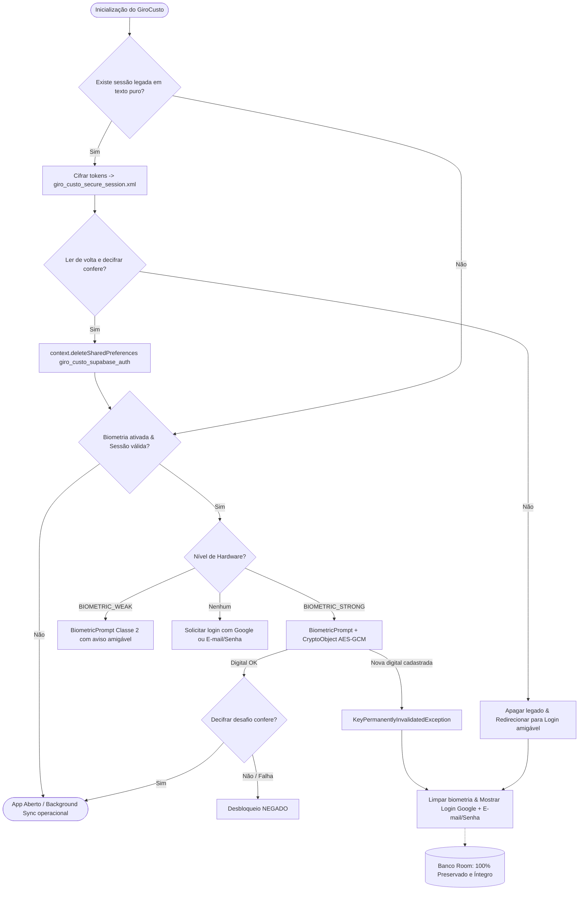

# Desenho Técnico: Sessão Segura e Biometria com Android Keystore (T-06)
> Arquitetura de segurança, criptografia em repouso e autenticação biométrica para o GiroCusto (Homologado com as 7 Condições Obrigatórias).

---

## 1. Arquitetura de Duas Chaves (Two-Key Architecture)
Para conciliar proteção física de credenciais com execução ininterrupta de rotinas em segundo plano (sincronização offline-first e renovação de tokens pelo WorkManager), o sistema separa as responsabilidades em duas chaves distintas no **Android Keystore** (`AndroidKeyStore` provider). A biblioteca legada `androidx.security:security-crypto` foi descontinuada pelo Google e é expressamente evitada devido a falhas conhecidas de corrupção de chaves.
- **`giro_custo_session_key` (Persistência de Tokens):** Chave simétrica AES-256-GCM (`KeyProperties.KEY_ALGORITHM_AES`, `BLOCK_MODE_GCM`, `ENCRYPTION_PADDING_NONE`, 256 bits) com `setUserAuthenticationRequired(false)`. Responsável por cifrar e decifrar os tokens (`access_token`, `refresh_token`, `user_id`, `email`) persistidos em disco.
- **`giro_custo_biometric_auth_key` (Desbloqueio de Interface):** Chave simétrica AES-256-GCM (`KeyProperties.KEY_ALGORITHM_AES`, `BLOCK_MODE_GCM`, `ENCRYPTION_PADDING_NONE`, 256 bits) com `setUserAuthenticationRequired(true)` e `setInvalidatedByBiometricEnrollment(true)`. Protege o acesso ao app no `AuthGateScreen`, acoplada ao hardware via `BiometricPrompt.CryptoObject`.

---

## 2. Proteção de Tokens & Sincronização em Segundo Plano (WorkManager/Coroutines)
- **Configuração da Chave de Sessão:** Gerada via `KeyGenParameterSpec.Builder("giro_custo_session_key", PURPOSE_ENCRYPT or PURPOSE_DECRYPT).setBlockModes(BLOCK_MODE_GCM).setEncryptionPaddings(ENCRYPTION_PADDING_NONE).setKeySize(256).setUserAuthenticationRequired(false).build()`.
- **Justificativa de Background:** O GiroCusto sincroniza dados (corridas, despesas, hodômetros) em segundo plano com corrotinas e WorkManager mesmo com o aparelho bloqueado. Exigir biometria nessa chave impediria a renovação periódica de tokens (`refreshCurrentSession`) e a sincronização offline, forçando interrupções constantes do motorista durante corridas.
- **Formato em Disco:** Cifra autenticada gerando IV (12 bytes) + Ciphertext + Tag GCM (128 bits). O payload serializado (Base64 com separador `:` para o IV) é gravado no SharedPreferences isolado `giro_custo_secure_session.xml`.
- **Gravação Síncrona e Proteção por Mutex (Condição 5):** A renovação de sessão (`refreshCurrentSession`) é estritamente protegida por `kotlinx.coroutines.sync.Mutex` (`refreshMutex.withLock`) para evitar chamadas concorrentes e perda do refresh token descartável do Supabase. A gravação do novo token e sessão no armazenamento seguro utiliza obrigatoriamente persistência síncrona com `commit()`, nunca `apply()`.

---

## 3. Proteção Biométrica Forte com CryptoObject Real & Desafio Criptográfico (Condição 2)
- **Configuração da Chave Biométrica:** Gerada no Keystore com `setUserAuthenticationRequired(true)`, `setInvalidatedByBiometricEnrollment(true)`, `BLOCK_MODE_GCM` e `ENCRYPTION_PADDING_NONE` (AES-256-GCM).
- **Operação Criptográfica Real e Conferida:**
  1. O sistema define um desafio criptográfico determinístico (`giro_custo_biometric_challenge`).
  2. Na primeira habilitação da biometria, o `BiometricPrompt` opera com `CryptoObject` em modo `ENCRYPT_MODE`. Após o sucesso da digital, o Cipher cifra o desafio e salva o IV e o texto cifrado no SharedPreferences de biometria.
  3. No fluxo de desbloqueio em `AuthGateScreen`, o `BiometricHelper` recupera o IV do desafio gravado, inicializa o `Cipher` em modo `DECRYPT_MODE` com `GCMParameterSpec(128, iv)` e o encapsula em `BiometricPrompt.CryptoObject(cipher)`.
  4. O Cipher só é operacionalizado pela TEE/SE após a validação biométrica positiva do hardware.
  5. Em `onAuthenticationSucceeded`, o `cipher` autenticado decifra o desafio guardado (`cipher.doFinal(encryptedChallenge)`). O resultado é confrontado com o desafio esperado:
     - Se o resultado decifrado for idêntico ao desafio: o desbloqueio é autorizado.
     - Se a decifração falhar, lançar exceção ou o valor não conferir: o desbloqueio é terminantemente **NEGADO**.
- **Detecção de Novas Digitais:** Se uma nova digital for cadastrada no Android (ex.: celular emprestado ou PIN descoberto), o hardware invalida a chave irreversivelmente, disparando `KeyPermanentlyInvalidatedException` na inicialização do Cipher.

---

## 4. Comportamento em Aparelhos sem BIOMETRIC_STRONG (Condição 3)
- **Problema de Compatibilidade:** O Android Keystore rejeita vincular `CryptoObject` a autenticadores fracos (`BIOMETRIC_WEAK`, como reconhecimento facial 2D por câmera) ou quando o dispositivo possui apenas credenciais de tela (`DEVICE_CREDENTIAL` - PIN/Padrão/Senha).
- **Decisão e Implementação:**
  1. **NÃO remover o bloqueio em silêncio:** O aplicativo nunca deve desativar ou ignorar o bloqueio apenas porque o aparelho não possui sensor biométrico de Classe 3 (`BIOMETRIC_STRONG`).
  2. **Classificação do Nível de Proteção:**
     - **`BIOMETRIC_STRONG` (Classe 3):** Proteção biométrica de alta segurança com `CryptoObject` real no Keystore (desafio AES-GCM).
     - **`BIOMETRIC_WEAK` (Classe 2):** Proteção biométrica padrão do dispositivo. O app informa ao usuário o nível de proteção disponível ("Proteção biométrica padrão do aparelho") e mantém o `BiometricPrompt` ativo via autenticador suportado (`BIOMETRIC_WEAK`), garantindo que o app permaneça bloqueado.
     - **Sem Biometria Enrolada / Apenas PIN:** O app informa a necessidade de autenticação por e-mail/senha ou Google, preservando a tela de bloqueio.
  3. **Transparência UX:** A interface indica ao motorista de forma clara o status da segurança sem termos técnicos intimidador.

---

## 5. Recuperação Graciosa & Usuários Google sem Senha (Condição 1)
- **Cenários de Falha / Recuperação:**
  - `KeyPermanentlyInvalidatedException` (nova digital cadastrada no SO);
  - Sessão ausente, corrompida ou `AEADBadTagException` (adulteração/restauração em outro aparelho);
  - `UnrecoverableKeyException` ou remoção do bloqueio de tela do SO.
- **Fluxo de Recuperação Obrigatório:**
  1. O app intercepta todas as exceções criptográficas sem quebrar (`crash-free`).
  2. Limpa as preferências biométricas inválidas (`BiometricHelper.clearBiometrics()`) e revoga a sessão em memória sem tocar no banco de dados.
  3. **Inviolabilidade dos Dados Locais (Room):** O banco de dados SQLite/Room (`giro_custo_database`) **JAMAIS** é apagado ou resetado nesse fluxo. Lançamentos, despesas e veículos locais permanecem intactos.
  4. **Suporte Completo a Usuários Google:** Usuários que entraram via Google **não possuem senha** no Supabase. Em qualquer situação de recuperação, a tela de autenticação (`AuthGateScreen`) deve exibir:
     - Botão em destaque "Continuar com o Google";
     - Formulário alternativo de e-mail e senha;
     - Mensagem amigável em português explicando a situação: *"Por segurança, sua sessão precisa ser revalidada. Entre novamente com sua conta Google ou com seu e-mail e senha."*

---

## 6. Migração Segura com Verificação Prévia e Remoção Total (Condição 4)
- **Gatilho de Boot:** Na inicialização do cliente seguro, verifica-se a presença de tokens no SharedPreferences legado `giro_custo_supabase_auth`.
- **Procedimento Atômico:**
  1. Leitura em memória dos tokens legados em texto puro (`sp_access_token`, `sp_refresh_token`, `sp_user_id`, `sp_user_email`).
  2. Cifragem com `giro_custo_session_key` e persistência síncrona (`commit()`) no arquivo seguro `giro_custo_secure_session.xml`.
  3. **Verificação Mandatória (Read-back):** LER DE VOLTA do `giro_custo_secure_session.xml` e decifrar os dados. Conferir campo a campo se a sessão decifrada é idêntica à sessão legada.
  4. **Expurgo Seguro do Arquivo Antigo:** Somente após a confirmação exata do read-back, o arquivo antigo é completamente deletado do sistema com `context.deleteSharedPreferences("giro_custo_supabase_auth")` (não apenas `.clear()`).
  5. **Tratamento de Falha na Migração:** Se a cifragem ou a leitura de volta falharem, o aplicativo não trava: apaga o SharedPreferences antigo para evitar repetição de erro, limpa o estado e redireciona o usuário para o login com a mensagem amigável de revalidação.

---

## 7. Isolamento de Hardware, Testabilidade em Memória & Confiabilidade (Condições 6 e 7)
- **Classe Pequena e Isolada do Keystore (Condição 7):** O código que invoca o `AndroidKeyStore` real fica restrito a um objeto pequeno e isolado (`AndroidKeyStoreHelper.kt`), sem espalhar dependências de hardware pelo código de negócio ou UI. Não se declara 100% de cobertura sintética para o hardware do Keystore; o status da tarefa é mantido em 🟡 **IMPLEMENTADO, NÃO VERIFICADO NO APARELHO** até a validação física no aparelho real pelo usuário.
- **Implementação em Memória por Padrão em Testes (Condição 6):**
  - O contrato de sessão define a interface `SecureSessionStorage`.
  - A implementação de produção é `EncryptedSharedPreferencesStorage` (utilizando `AndroidKeyStoreHelper`).
  - A implementação de teste é `InMemorySessionStorage`, mantendo os tokens estritamente na memória volátil durante a execução dos testes JVM / Robolectric.
  - O método `SupabaseClient.resetForTesting(context)` utiliza `InMemorySessionStorage` por padrão, e o fallback defensivo de ambiente garante que nenhum dos 161 testes existentes seja alterado, enfraquecido ou quebrado.
- **Regras de Backup:** O arquivo `giro_custo_secure_session.xml` já se encontra devidamente excluído de backups em nuvem e transferências D2D em `data_extraction_rules.xml` e `backup_rules.xml` (entregues na T-02).

---

## 8. Diagrama do Fluxo Operacional

