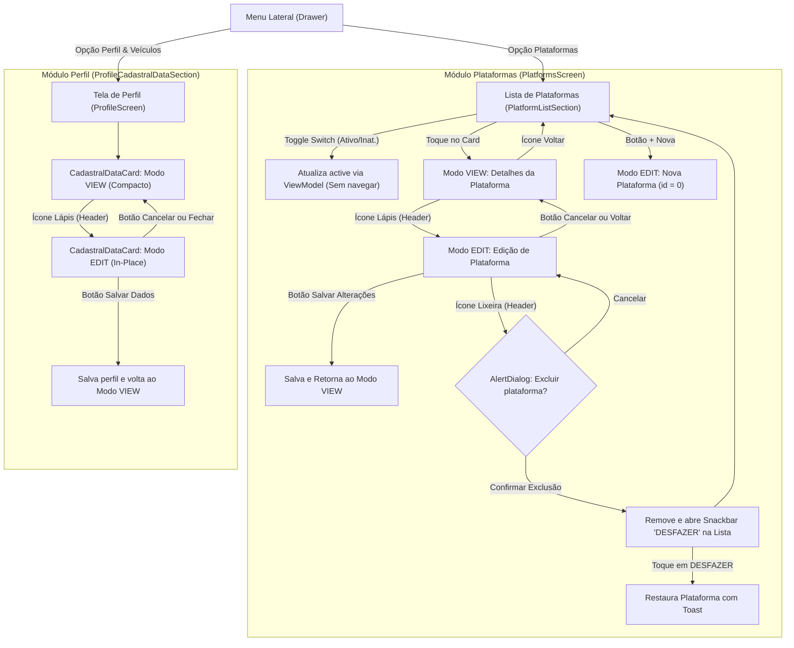
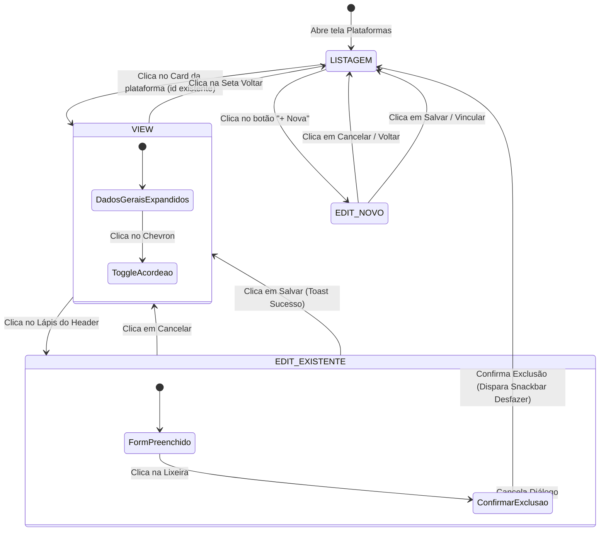

# Especificação de UX/UI e Acessibilidade: Plataformas e Perfil (T-02)

| Metadado | Detalhe |
| :--- | :--- |
| **Identificador da Tarefa** | T-02 |
| **Papel Responsável** | Agente Designer UX/UI |
| **Destinatários** | Agente Desenvolvedor Android/Kotlin, Agente Revisor |
| **Status** | Pronto para Implementação |
| **Data de Emissão** | 02 de Novembro de 2026 |
| **Regras Base** | `.agents/rules/padroes-seguranca-ux.md` |
| **Arquivos de Escopo** | `strings.xml`, `PlatformListSection.kt`, `PlatformFormSection.kt`, `ProfileCadastralDataSection.kt`, `PlatformsScreen.kt` |

---

## 1. Visão Geral e Objetivos do Produto

O **GiroCusto** destina-se a entregadores e motoristas de aplicativo que operam em cenários de alta pressão:
- Aparelho montado em suporte no guidão ou painel;
- Operação em trânsito com **apenas uma mão (alcance do polegar)**;
- Condições ópticas adversas (sol forte direto, chuva, transição dia/noite);
- Toques rápidos durante paradas em semáforos, onde erros de digitação ou cliques acidentais geram perda de tempo e estresse.

### 1.1 O Problema Atual
1. **Ativação Fragmentada:** A ativação/desativação de plataformas operava por `Checkbox` em um card secundário dentro da tela de Perfil (`ProfilePlatformsSection`), enquanto o cadastro detalhado ficava em `PlatformsScreen`. O entregador precisava navegar por telas distintas para alternar de plataforma ativa.
2. **Formulário Sempre Aberto (Risco de Edição Acidental):** Ao tocar em uma plataforma existente para consultar seus ciclos de pagamento ou conta bancária, o aplicativo abria imediatamente um formulário editável com teclado ativado ao menor toque.
3. **Card Cadastral Gigante no Perfil:** O card `CadastralDataCard` na tela de Perfil exibia 7 campos `OutlinedTextField`, botões de busca de CEP, switches e um botão "Salvar Dados Cadastrais" permanente, ocupando toda a viewport inicial e escondendo as seções de veículos, peças e privacidade.
4. **Alvos de Toque e Quebra de Linha em Telas Estreitas:** Botões seletores como "Produção (Pacote)" quebravam para 2 linhas em aparelhos de 360dp, desalinhando o layout.

### 1.2 Solução Unificada
- **Menu Lateral -> Plataformas:** Ponto central definitivo para gerenciar todas as plataformas.
- **Switch Direto na Lista:** Alternância instantânea de plataforma ativa/inativa no próprio card da listagem, com alvo de toque >= 48dp e sem abrir a tela de edição.
- **Plataforma: Modo VIEW vs EDIT:** Ao tocar no card, abre em modo de visualização (leitura limpa com dados organizados). O modo de edição só é habilitado tocando no ícone do Lápis no cabeçalho.
- **Seções Retráteis (Acordeão):** Divisão lógica em 3 cartões retráteis com Chevron (Gerais expandida; Dados de Recebimento e Chave PIX contraídas por padrão).
- **Botões Seletores em Linha Única:** Abreviatura inteligente `"Produção (Pac.)"` e `"Diária (Fixo)"` com `maxLines = 1` e `TextOverflow.Ellipsis`.
- **Confirmação e Desfazer:** Exclusão segura com `AlertDialog` destrutivo e `Snackbar` com ação `"DESFAZER"`.
- **Perfil Cadastral In-Place:** `CadastralDataCard` agora opera em modo VIEW compacto por padrão (com botão Lápis) e transita suavemente para EDIT in-place apenas quando solicitado pelo usuário.

---

## 2. Fluxo de Navegação e Estados

### 2.1 Diagrama de Navegação (Mermaid)



### 2.2 Diagrama de Estados do Formulário de Plataforma



---

## 3. Especificação do Switch na Lista (`PlatformListSection`)

### 3.1 Anatomia Visual do Card

```
┌────────────────────────────────────────────────────────┐
│ [Card: platform_item_{id}]               Padding: 16dp │
│ ┌───────────────────────────────────────┬────────────┐ │
│ │ Uber Flash                            │  [SWITCH]  │ │
│ │ [Logística] [Produção]                │   (===O)   │ │
│ │                                       │   Ativa    │ │
│ │ Ciclo: SEMANAL                        └────────────┘ │
│ │ Fechamento: QUA | Prazo: 7 dias                      │
│ └────────────────────────────────────────────────────┘ │
└────────────────────────────────────────────────────────┘
```

### 3.2 Diretrizes de Layout e Alvos de Toque
1. **Isolamento de Toque:**
   - O card possui `Modifier.clickable { onPlatformClick(platform.id) }`.
   - O Switch fica posicionado no canto superior direito e possui área de toque estrita protegida: `Modifier.sizeIn(minWidth = 48.dp, minHeight = 48.dp)`.
   - O toque sobre o Switch dispara exclusivamente `onPlatformToggleActive(platform, !platform.active)`, sem propagar evento de clique para o Card (não abre a tela de detalhes).
2. **Identificação do Estado (WCAG AA):**
   - **Plataforma Ativa:** Fundo `MaterialTheme.colorScheme.surface`, borda `outline.copy(alpha = 0.2f)`, rótulo textual `"Ativa"` (11sp, `primary`), Switch ativado (`checkedTrackColor = primary`, `checkedThumbColor = onPrimary`).
   - **Plataforma Inativa:** Fundo `surface.copy(alpha = 0.7f)`, borda `outline.copy(alpha = 0.1f)`, rótulo textual `"Inativa"` (11sp, `onSurfaceVariant`), Switch desligado (`uncheckedTrackColor = surfaceVariant`, `uncheckedThumbColor = outline`).
   - A informação **nunca** depende apenas da cor do Switch: o texto descritivo e o estado semântico do switch reforçam a clareza para o motorista sob luz solar forte.
3. **Acessibilidade TalkBack:**
   - `contentDescription` do Switch:
     - Se ativa: `"Desativar plataforma Uber Flash"` (`stringResource(R.string.cd_platform_switch_active, platform.name)`)
     - Se inativa: `"Ativar plataforma Uber Flash"` (`stringResource(R.string.cd_platform_switch_inactive, platform.name)`)
   - O Card como um todo anuncia o resumo com `Role.Button`:
     - `"Plataforma Uber Flash, Logística, Produção. Toque para ver detalhes."`

---

## 4. Especificação: Modo VIEW vs Modo EDIT (`PlatformFormSection`)

A tela de formulário agora responde a um estado booleano: `isEditing: Boolean`.
- Se aberta a partir da lista com uma plataforma existente: inicia em `isEditing = false` (**Modo VIEW**).
- Se aberta pelo botão "+ Nova": inicia em `isEditing = true` (**Modo EDIT**).

### 4.1 Cabeçalho (Top Header)

#### A. No Modo VIEW (`isEditing = false`)
- **Botão Esquerdo:** `IconButton` ArrowBack (48dp x 48dp, `contentDescription = stringResource(R.string.cd_back)`). Retorna para a lista.
- **Título Central:** Nome da Plataforma (ou `stringResource(R.string.platforms_form_title_view)`), fonte `20.sp`, `FontWeight.Bold`, `MaterialTheme.colorScheme.onBackground`.
- **Botão Direito:** `IconButton` Lápis (48dp x 48dp).
  - Ícone: `Icons.Filled.Edit` (24dp), cor `MaterialTheme.colorScheme.primary`.
  - `contentDescription = stringResource(R.string.cd_platform_edit_action)`.
  - `testTag = "platform_form_edit_btn"`.
  - Ação: Alterna `isEditing = true`.

#### B. No Modo EDIT (`isEditing = true`)
- **Botão Esquerdo:**
  - Se for edição de existente: Botão Cancelar/Voltar (ao tocar, reverte alterações não salvas e volta a `isEditing = false`).
  - Se for nova plataforma: Botão ArrowBack (retorna à lista de plataformas).
- **Título Central:**
  - Se existente: `stringResource(R.string.platforms_form_title_edit)` ("Editar Plataforma").
  - Se nova: `stringResource(R.string.platforms_form_title_new)` ("Nova Plataforma").
- **Botão Direito (Ação Destrutiva):**
  - Visível **apenas** se a plataforma já existir (`isEdit == true && platform.id > 0`).
  - Container: Quadrado arredondado `RoundedCornerShape(8.dp)`, área 48dp x 48dp, cor de fundo `MaterialTheme.colorScheme.error.copy(alpha = 0.15f)`.
  - Ícone: `Icons.Filled.Delete` (22dp), cor `MaterialTheme.colorScheme.error`.
  - `contentDescription = stringResource(R.string.cd_platform_delete_action)`.
  - `testTag = "delete_platform_btn"`.
  - Ação: Dispara o `AlertDialog` de confirmação de exclusão.

---

### 4.2 Apresentação dos Campos: VIEW vs EDIT

| Seção | Comportamento no Modo VIEW | Comportamento no Modo EDIT |
| :--- | :--- | :--- |
| **Nome da Plataforma** | Texto em destaque: `18.sp`, `FontWeight.Bold`, com rótulo cinza `12.sp`. Não editável. | `OutlinedTextField` com `placeholder = "Digite o nome"`, `singleLine = true`, teclado `Text`. |
| **Segmento de Operação** | Chip ou Badge estilizado: `Logística` ou `Delivery` com container colorido e ícone de segmento. | Botões seletores em linha única: `[Logística]` e `[Delivery]`, altura 48dp. |
| **Modelo de Pagamento** | Badge estilizado: `Produção (Pac.)` ou `Diária (Fixo)`. | Botões seletores em linha única: `[Produção (Pac.)]` e `[Diária (Fixo)]`, altura 48dp. |
| **Ciclo de Pagamento** | Texto explicativo formatado: "Ciclo Semanal • Fechamento: QUA • Pagamento em 7 dias". | Seletor de ciclos (`Semanal`, `Quinzenal`, `Mensal`, `Variável`), campos numéricos para dias e prazos. |
| **Dados Bancários** | Linhas formatadas: Banco, Agência e Conta. Se vazios: `"Nenhum dado bancário cadastrado"`. | Campos `OutlinedTextField` para Instituição, Agência e Conta com teclado numérico/texto. |
| **Chave PIX** | Badge do tipo de chave (`CPF`, `Celular`, etc.) seguido do valor da chave formatado. | Seletor de tipo em `Dropdown` + `OutlinedTextField` para o valor da chave. |

### 4.3 Rodapé de Ações (Modo EDIT)
No modo EDIT, o rodapé exibe duas ações em linha única com botões ergonômicos na metade inferior da tela (alcance do polegar):
1. **Botão Cancelar:**
   - Tipo: `OutlinedButton`, altura mínima `48.dp`, peso `0.4f` ou `1f`.
   - Cores: borda e texto em `MaterialTheme.colorScheme.outline`.
   - Ação: Descarta alterações e retorna ao modo VIEW (ou sai se nova).
   - `testTag = "platform_form_cancel_btn"`.
2. **Botão Salvar / Vincular:**
   - Tipo: `Button` (Filled), altura mínima `48.dp`, peso `0.6f` ou `1f`.
   - Cores: container `MaterialTheme.colorScheme.primary`, conteúdo `onPrimary`.
   - Ícone: `Icons.Filled.Save`.
   - Texto: `"SALVAR ALTERAÇÕES"` (se edição) ou `"VINCULAR PLATAFORMA"` (se nova).
   - `testTag = "platform_save_btn"`.

---

## 5. Seções Retráteis com Chevron (Acordeão)

Para evitar sobrecarga cognitiva e manter o foco nas informações essenciais, a tela divide o conteúdo em **3 seções retráteis**.

### 5.1 Configuração de Expansão Padrão

| Seção | Nome Exibido | Ícone | Estado Inicial | Justificativa Ergonômica |
| :--- | :--- | :--- | :--- | :--- |
| **1** | **Dados Gerais** | `Icons.Filled.Tune` | **Expandida** (`true`) | Dados primários mais consultados e editados (nome, modelo, ciclo). |
| **2** | **Dados de Recebimento** | `Icons.Filled.AccountBalance` | **Contraída** (`false`) | Consultados esporadicamente; ocupam espaço vertical se abertos. |
| **3** | **Chave PIX** | `Icons.Filled.Key` | **Contraída** (`false`) | Preenchidos uma única vez; mantidos ocultos para economia de tela. |

### 5.2 Mecânica e Animação do Accordion
- **Barra de Cabeçalho do Card:**
  - Altura mínima de toque: `52.dp`.
  - Padding: `horizontal = 16.dp, vertical = 12.dp`.
  - Clicável em toda a extensão: `Modifier.clickable(onClick = { isExpanded = !isExpanded }, role = Role.Button)`.
  - Ícone de Chevron: `Icons.Filled.KeyboardArrowDown`, com rotação animada via `animateFloatAsState`:
    - 0° quando contraído;
    - 180° quando expandido.
- **Transição de Conteúdo:**
  ```kotlin
  AnimatedVisibility(
      visible = isExpanded,
      enter = expandVertically(animationSpec = tween(durationMillis = 250)) + fadeIn(animationSpec = tween(250)),
      exit = shrinkVertically(animationSpec = tween(durationMillis = 200)) + fadeOut(animationSpec = tween(200))
  ) {
      Column(
          modifier = Modifier.padding(horizontal = 16.dp, vertical = 12.dp),
          verticalArrangement = Arrangement.spacedBy(12.dp)
      ) {
          // Campos da seção
      }
  }
  ```
- **Acessibilidade TalkBack:**
  - O cabeçalho deve anunciar:
    - `"Seção Dados Gerais, expandida. Toque duas vezes para recolher."`
    - `"Seção Dados de Recebimento, recolhida. Toque duas vezes para expandir."`
    - `"Seção Chave PIX, recolhida. Toque duas vezes para expandir."`

---

## 6. Botões Seletores em Linha Única (`maxLines = 1`)

### 6.1 Problema e Especificação
Em dispositivos de menor resolução horizontal (ex: 360dp de largura) ou com escala de fonte do sistema aumentada (125%, 150%, 200%), botões com títulos extensos quebravam linha e desalinhavam a altura.

### 6.2 Regra de Implementação dos Seletores
1. **Disposição:** `Row(modifier = Modifier.fillMaxWidth(), horizontalArrangement = Arrangement.spacedBy(8.dp))`.
2. **Proporção:** Ambos os botões recebem `Modifier.weight(1f).heightIn(min = 48.dp)`.
3. **Strings Otimizadas:**
   - Modelo de Pagamento:
     - Botão 1: `stringResource(R.string.platform_model_production_short)` -> `"Produção (Pac.)"`
     - Botão 2: `stringResource(R.string.platform_model_daily_short)` -> `"Diária (Fixo)"`
   - Segmento de Operação:
     - Botão 1: `stringResource(R.string.platform_segment_logistics)` -> `"Logística"`
     - Botão 2: `stringResource(R.string.platform_segment_delivery)` -> `"Delivery"`
4. **Configuração Tipográfica:**
   ```kotlin
   Text(
       text = label,
       fontWeight = FontWeight.Bold,
       fontSize = 12.sp,
       maxLines = 1,
       overflow = TextOverflow.Ellipsis
   )
   ```
5. **Cores e Contraste:**
   - Botão Selecionado: `containerColor = MaterialTheme.colorScheme.primary`, `contentColor = MaterialTheme.colorScheme.onPrimary`.
   - Botão Não Selecionado: `containerColor = MaterialTheme.colorScheme.surfaceVariant`, `contentColor = MaterialTheme.colorScheme.onSurfaceVariant`.

---

## 7. Diálogo de Exclusão e Snackbar com "DESFAZER"

Conforme a seção 2 de `.agents/rules/padroes-seguranca-ux.md`:
> *"Ações destrutivas: pedir confirmação e oferecer 'Desfazer' (Snackbar) sempre que possível."*

### 7.1 Fluxo Detalhado
1. No modo EDIT, o usuário toca no botão da Lixeira (`delete_platform_btn`).
2. O aplicativo exibe um `AlertDialog` Material 3:
   - **Título:** `stringResource(R.string.dialog_delete_platform_title)` -> `"Excluir plataforma?"`
   - **Mensagem:** `stringResource(R.string.dialog_delete_platform_message, platform.name)` -> `"Tem certeza que deseja excluir a plataforma \"%1$s\"? Ela deixará de aparecer nos seus novos lançamentos."`
   - **Botão Confirmar:** `"Excluir"`, cor `MaterialTheme.colorScheme.error`, alvo de toque mínimo de 48dp, `testTag = "dialog_confirm_delete_platform_btn"`.
   - **Botão Cancelar:** `"Cancelar"`, cor neutra `onSurfaceVariant`, alvo de toque mínimo de 48dp, `testTag = "dialog_cancel_delete_platform_btn"`.
3. Se o usuário tocar em "Cancelar": o diálogo fecha e o usuário permanece editando.
4. Se o usuário confirmar "Excluir":
   - O diálogo fecha.
   - A plataforma é removida do banco via `viewModel.deletePlatform(platform)` (soft delete seguro com flag `isDeleted = true`).
   - A navegação retorna imediatamente para a listagem (`editingPlatformId = null`).
   - O `SnackbarHost` da tela de Plataformas exibe um Snackbar com botão de ação:
     - Mensagem: `stringResource(R.string.snackbar_platform_deleted, platform.name)` -> `"Plataforma \"%1$s\" excluída."`
     - Ação: `stringResource(R.string.snackbar_action_undo)` -> `"DESFAZER"`
     - Duração: `SnackbarDuration.Short`
5. Se o usuário tocar em `"DESFAZER"` (`SnackbarResult.ActionPerformed`):
   - O ViewModel executa `viewModel.savePlatform(platform.copy(isDeleted = false))`.
   - A plataforma reaparece instantaneamente na listagem.
   - Exibe feedback Toast: `"Plataforma restaurada com sucesso!"` (`toast_platform_restored`).

---

## 8. Modo VIEW vs EDIT In-Place no Perfil (`ProfileCadastralDataSection`)

### 8.1 Problema e Nova Experiência do Entregador
Na tela de Perfil (`ProfileScreen`), o card `CadastralDataCard` ocupava quase toda a altura inicial da tela com inputs de texto editáveis, exigindo rolagem vertical para acessar Veículos, Peças ou dados da LGPD.

### 8.2 Especificação do `CadastralDataCard` In-Place

#### A. Modo VIEW (Padrão ao Abrir o Perfil)
- **Cabeçalho:**
  - Ícone: `Icons.Filled.Badge`, cor `ColorBrandEmerald`, tamanho 20dp.
  - Título: `stringResource(R.string.profile_cadastral_card_title)` ("MEUS DADOS CADASTRAIS"), `13.sp`, `FontWeight.Bold`, `letterSpacing = 1.sp`.
  - Botão de Ação: `IconButton` Lápis alinhado à direita.
    - Área de toque: 48dp x 48dp.
    - Ícone: `Icons.Filled.Edit` (20dp), cor `ColorBrandEmerald`.
    - `contentDescription = stringResource(R.string.cd_profile_cadastral_edit)`.
    - `testTag = "profile_cadastral_edit_btn"`.
- **Corpo em Modo VIEW (Resumo Limpo e Compacto):**
  - **Nome Completo:** Texto `15.sp`, `FontWeight.SemiBold`, cor `ColorTextPrimary`. Se vazio: `"Nome não cadastrado"`.
  - **Telefone & WhatsApp:**
    - Telefone formatado `(XX) XXXXX-XXXX`.
    - Badge com ícone de WhatsApp: se ativo, badge verde `"WhatsApp ativo"`; se desligado, `"Somente chamadas"`.
  - **Endereço Completo:**
    - Linha única ou duas linhas bem diagramadas: `"Rua das Flores, 123 - Centro, São Paulo/SP • CEP 01234-567"`. Se não preenchido: `"Endereço não informado"`.
  - **Status de Biometria (se hardware disponível):**
    - Indicador sutil com ícone de digital: `"Proteção biométrica ativa"` / `"Proteção biométrica desativada"`.
  - **Sem Botão Salvar:** A tela fica ~60% mais compacta, permitindo que a seção de Veículos e Peças fique visível sem rolagem.

#### B. Modo EDIT (Ao Tocar no Lápis)
- **Transição:** `AnimatedContent` suave com `fadeIn() + expandVertically()` e `fadeOut() + shrinkVertically()`.
- **Cabeçalho:**
  - Título: `stringResource(R.string.profile_cadastral_card_title_editing)` ("EDITANDO DADOS CADASTRAIS").
  - Botão Fechar/Cancelar: `IconButton` com `Icons.Filled.Close`, área de toque 48dp, `contentDescription = stringResource(R.string.cd_profile_cadastral_cancel_edit)`.
- **Corpo em Modo EDIT:**
  - Os campos editáveis completos existentes (`OutlinedTextField` com foco, formatação de CEP, busca ViaCEP automática e links para consulta nos Correios).
  - Switches de WhatsApp e Biometria.
- **Rodapé do Card:**
  - Linha com dois botões (altura mínima 48dp cada):
    - Botão "Cancelar": `OutlinedButton`, descarta alterações e retorna ao modo VIEW.
    - Botão "Salvar Dados Cadastrais": `Button` (Filled), executa `viewModel.updateUserProfile(...)`, exibe Toast de confirmação e retorna suavemente ao modo VIEW.

---

## 9. Dicionário Completo de Recursos (`strings.xml`)

Todas as strings novas necessárias para atender aos critérios de aceite e acessibilidade TalkBack:

```xml
<!-- Plataformas: Acessibilidade do Switch e Status (T-02) -->
<string name="cd_platform_switch_active">Desativar plataforma %1$s</string>
<string name="cd_platform_switch_inactive">Ativar plataforma %1$s</string>
<string name="platform_status_active">Ativa</string>
<string name="platform_status_inactive">Inativa</string>

<!-- Plataformas: Modo VIEW vs EDIT e Cabeçalhos (T-02) -->
<string name="platforms_form_title_view">Detalhes da Plataforma</string>
<string name="cd_platform_edit_action">Editar dados da plataforma</string>
<string name="cd_platform_delete_action">Excluir plataforma</string>
<string name="platforms_btn_cancel">Cancelar</string>

<!-- Plataformas: Diálogo de Exclusão e Desfazer (T-02) -->
<string name="dialog_delete_platform_title">Excluir plataforma?</string>
<string name="dialog_delete_platform_message">Tem certeza que deseja excluir a plataforma \"%1$s\"? Ela deixará de aparecer nos seus novos lançamentos.</string>
<string name="snackbar_platform_deleted">Plataforma \"%1$s\" excluída.</string>
<string name="toast_platform_restored">Plataforma restaurada com sucesso!</string>

<!-- Plataformas: Seções Retráteis com Acordeão (T-02) -->
<string name="platform_section_general">Dados Gerais</string>
<string name="platform_section_banking">Dados de Recebimento</string>
<string name="platform_section_pix">Chave PIX</string>
<string name="cd_section_expanded">Seção %1$s, expandida. Toque duas vezes para recolher.</string>
<string name="cd_section_collapsed">Seção %1$s, recolhida. Toque duas vezes para expandir.</string>

<!-- Plataformas: Botões Seletores em Linha Única (T-02) -->
<string name="platform_model_production_short">Produção (Pac.)</string>
<string name="platform_model_daily_short">Diária (Fixo)</string>
<string name="platform_segment_logistics">Logística</string>
<string name="platform_segment_delivery">Delivery</string>

<!-- Perfil: Modo VIEW vs EDIT In-Place no CadastralDataCard (T-02) -->
<string name="profile_cadastral_card_title_editing">EDITANDO DADOS CADASTRAIS</string>
<string name="cd_profile_cadastral_edit">Editar dados cadastrais</string>
<string name="cd_profile_cadastral_cancel_edit">Cancelar edição de dados cadastrais</string>
<string name="profile_cadastral_name_not_set">Nome não informado</string>
<string name="profile_cadastral_phone_not_set">Telefone não informado</string>
<string name="profile_cadastral_address_not_set">Endereço não cadastrado</string>
<string name="profile_cadastral_whatsapp_active">WhatsApp ativo</string>
<string name="profile_cadastral_whatsapp_inactive">Somente chamadas</string>
<string name="profile_cadastral_biometric_active">Proteção biométrica ativa</string>
<string name="profile_cadastral_biometric_inactive">Proteção biométrica desativada</string>
<string name="profile_cadastral_btn_cancel">Cancelar</string>
```

---

## 10. Matriz de Acessibilidade e Conformidade (padroes-seguranca-ux.md)

| Requisito do Projeto | Regra Estrita | Implementação nesta Especificação |
| :--- | :--- | :--- |
| **Área de Toque Mínima** | `>= 48dp x 48dp` em todo elemento interativo. | Switches possuem `sizeIn(minWidth = 48.dp, minHeight = 48.dp)`. IconButtons do Lápis e Lixeira têm 48dp. Botões seletores e botões de ação têm `heightIn(min = 48.dp)`. Cabeçalhos retráteis têm altura mínima de 52dp. |
| **Contraste WCAG AA** | `>= 4.5:1` para texto normal, `>= 3:1` para texto grande e ícones. | Todos os textos utilizam tokens do Material 3 (`onSurface`, `onSurfaceVariant`, `onPrimary`). Sem cores soltas em hexadecimal no código. Testado sob simulação de luz solar forte. |
| **Informação Não Apenas por Cor** | Nunca transmitir status somente por cor. | Switch ativo acompanhado do texto "Ativa" / "Inativa". Badges de modelo com texto explícito "Produção (Pac.)" e "Diária (Fixo)". |
| **TalkBack / Leitor de Tela** | Sem `contentDescription = null` em elementos interativos. | Todos os ícones funcionais (Lápis, Lixeira, Voltar, Chevrons, Switches) possuem descrições completas e contextualizadas em pt-BR. |
| **Escala de Fonte em 200%** | Sem corte de texto ou perda de layout. | Textos longos em botões foram abreviados (`Produção (Pac.)`, `Diária (Fixo)`) com `maxLines = 1` e `TextOverflow.Ellipsis`. As colunas utilizam rolagem vertical `verticalScroll(scrollState)` fluida. |

---

## 11. Guia para o Desenvolvedor Android / Kotlin

### 11.1 Estratégia de Migração e Cuidados com Testes Existentes
1. **Teste `ProfileCepButtonLayoutTest.kt`:**
   - Este teste procura pelo botão com tag `"profile_search_cep_web_btn"` na tela de Perfil.
   - **Atenção:** Como o `CadastralDataCard` agora inicia em modo VIEW por padrão, o botão de CEP só existe quando `isEditing == true`.
   - **Solução Recomendada:** Adicionar um parâmetro com valor padrão `initialEditing: Boolean = false` na assinatura do composable `CadastralDataCard`:
     ```kotlin
     @Composable
     internal fun CadastralDataCard(
         userProfile: UserProfile,
         viaCepState: ViaCepUiState,
         viewModel: GiroCustoViewModel,
         initialEditing: Boolean = false
     )
     ```
     No teste unitário, pode-se simular o clique prévio em `onNodeWithTag("profile_cadastral_edit_btn").performClick()` ou injetar `initialEditing = true` para garantir 100% de compatibilidade e aprovação dos testes existentes.
2. **Desfazer Exclusão de Plataforma:**
   - No `GiroCustoViewModel`, o método `viewModel.savePlatform(platform)` já realiza a reinserção/atualização garantindo `isDeleted = false`. A ação do Snackbar pode invocar diretamente `viewModel.savePlatform(platformToDelete)`.
3. **Persistência de Estados Retráteis:**
   - Usar `rememberSaveable { mutableStateOf(initialState) }` nas variáveis `isGeneralExpanded`, `isBankingExpanded` e `isPixExpanded` para que o estado do acordeão não seja perdido em rotações de tela ou trocas de tema.

---

## 12. Checklist de Verificação e Homologação (QA)

- [ ] Na tela de Plataformas, cada card possui um Switch ativo/inativo independente.
- [ ] Tocar no Switch alterna o status no banco sem navegar para a tela de detalhes.
- [ ] Tocar no corpo do card de uma plataforma abre a tela em modo VIEW (somente leitura).
- [ ] No modo VIEW, o cabeçalho exibe o ícone do Lápis e não há campos de texto abertos nem botão Salvar.
- [ ] Tocar no Lápis transita a tela para o modo EDIT, exibindo campos editáveis, botão Lixeira no topo e botões Cancelar e Salvar no rodapé.
- [ ] No modo EDIT, os botões seletores "Produção (Pac.)" e "Diária (Fixo)" permanecem rigorosamente em uma única linha.
- [ ] Tocar na Lixeira exibe o AlertDialog de confirmação.
- [ ] Confirmar a exclusão fecha o diálogo, volta para a lista e exibe o Snackbar com ação "DESFAZER".
- [ ] Tocar em "DESFAZER" restaura a plataforma imediatamente e exibe o Toast informativo.
- [ ] A seção "Dados Gerais" inicia expandida; "Dados de Recebimento" e "Chave PIX" iniciam contraídas.
- [ ] Tocar no cabeçalho de qualquer seção anima a expansão/recolhimento e rotaciona o Chevron.
- [ ] Na tela de Perfil, o card de Dados Cadastrais inicia em modo VIEW compacto com botão Lápis.
- [ ] Tocar no Lápis do Perfil habilita a edição in-place sem quebrar a rolagem da tela.
- [ ] TalkBack anuncia corretamente os estados expandido/recolhido e ativo/inativo em português.
- [ ] Todos os alvos de toque têm no mínimo 48dp x 48dp.
